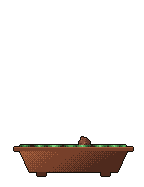

<h1 align="center">
  <a href="https://github.com/BeruCrypt02">
    
  </a>
</h1>

<p align="center">
  
</p>

```yaml
name:     beru
role:     android platform engineer
location: egypt
web:      beru.dev
```

<p align="center">
  <a href="https://t.me/BeruCrypt00"></a>
  <a href="mailto:berucrypt00@gmail.com"></a>
  <a href="https://github.com/BeruCrypt02"></a>
  
</p>

<p align="center">
  
</p>
